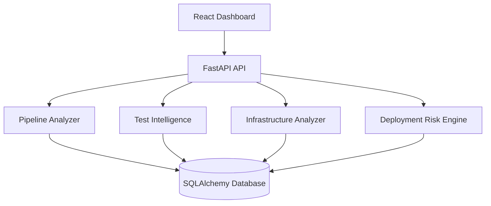

# DeployGuard Architecture

DeployGuard uses a modular monolith: the API, domain services, persistence, and integrations
run in one deployable process, while preserving module boundaries for future extraction.

## Module boundaries

- API routes validate HTTP input and delegate work.
- Services contain parsing and business rules.
- SQLAlchemy models own persistence.
- External integrations are isolated and optional.

## Data flow

Reports and workflow files are submitted locally. Services produce typed findings and domain
results, then relevant history is persisted. Static Terraform findings are never interpreted as
live cloud observations.
